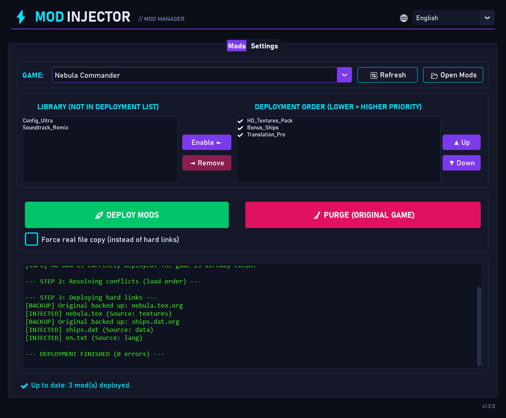
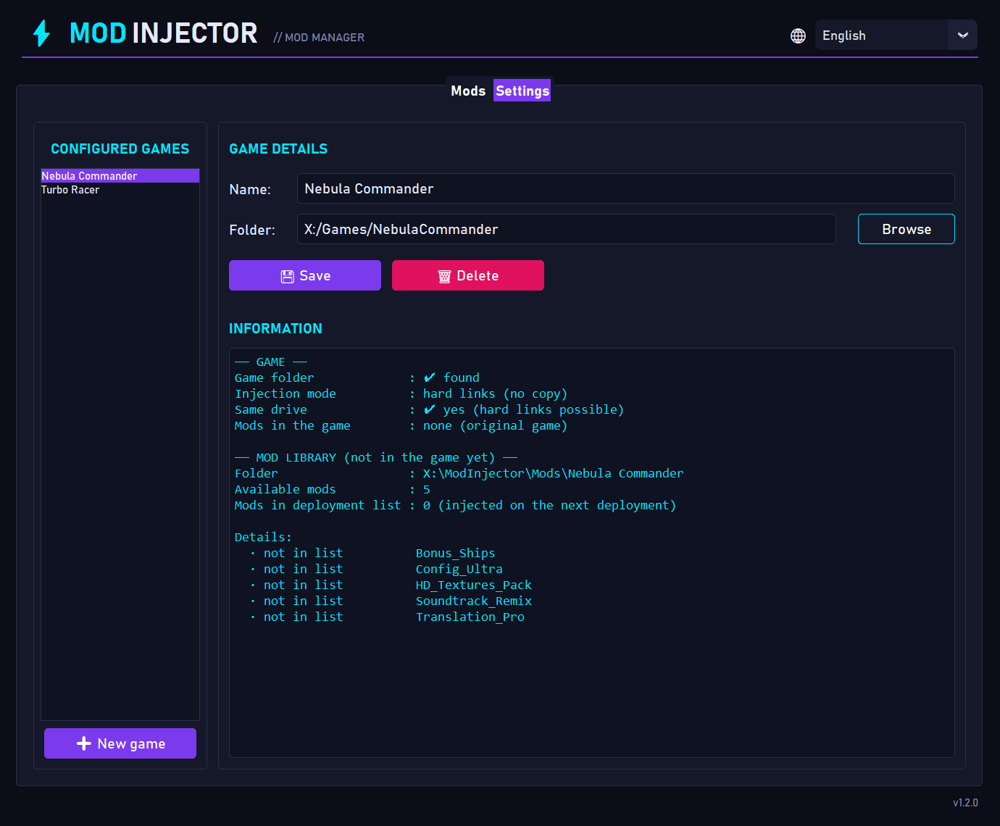
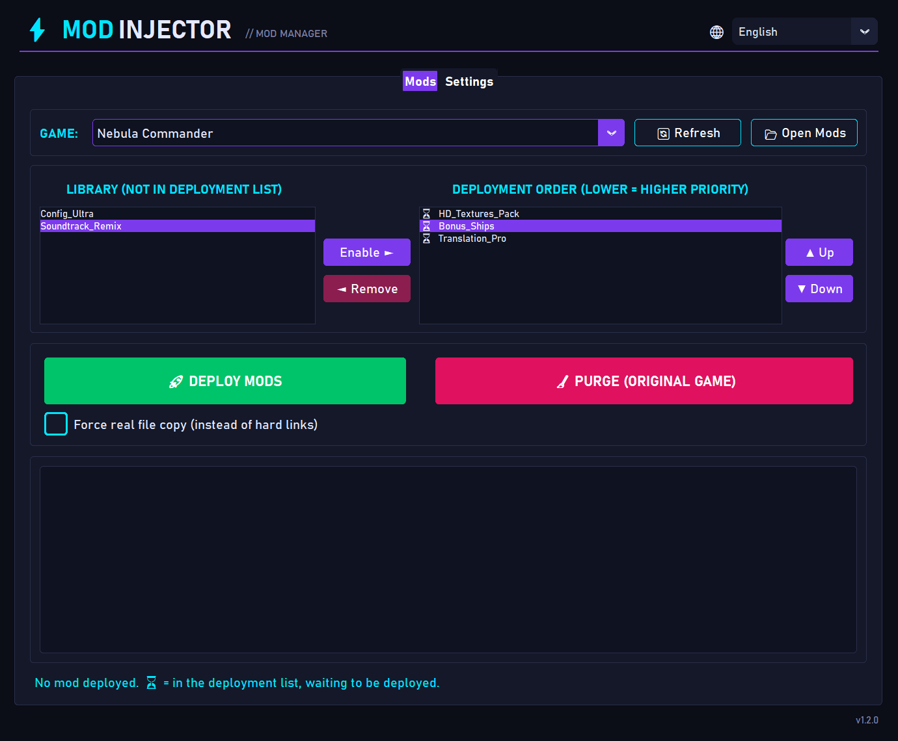

# ModInjector

🇫🇷 [Version française](README.fr.md)

[](https://github.com/devcfk/ModInjector/actions/workflows/ci.yml)

**ModInjector** is a simple, non-destructive mod manager for **Windows** games.
Organize your mods, choose their load order, inject them into your game in one click — and **restore the original game** just as easily.



> 🌐 The interface is available in **English** and **French**. It follows the Windows display language; you can change it at any time with the 🌐 selector at the top right of the window.

📘 **New here?** The illustrated [user manual](docs/Manuel_utilisateur_ModInjector.docx) (Word, in French) walks you through it step by step.

## ✨ Features

- 🎮 **Multiple games**: manage several games, each with its own mod library.
- 📚 **Mod library**: drop your mods into a folder and ModInjector detects them automatically.
- 🔢 **Load order**: when two mods conflict, the one lower in the list wins.
- ⚡ **Instant injection**: uses *hard links* (no copy, 0 extra bytes on disk).
- 📄 **Optional real copy**: a per-game checkbox forces real file copies instead of hard links.
- 🛡️ **Non-destructive**: original game files are backed up (`.org`) and restored on purge.
- 🧹 **One-click purge**: removes every mod and puts the game back in its original state.
- 🕹️ **Gaming UI**: dark theme with neon accents and a terminal-style log.
- 🌐 **English and French**: follows the Windows language, switchable from the window.

## 📥 Installation

1. Download the latest `ModInjector.zip` from the [Releases](https://github.com/devcfk/ModInjector/releases) page.
2. Extract the archive **on the same drive as your game** (see [Limitations](#️-limitations)).
3. Run `ModInjector.exe`.

The extracted folder contains:

```
ModInjector/
├── ModInjector.exe
├── Mods/      ← your mods (one subfolder per game)
└── data/      ← settings (config.json)
```

No Python installation is required.

## 🚀 Usage

### 1. Add a game
1. Open the **Settings** tab.
2. Click **➕ New game**, enter a name and select the **game's root folder** (**Browse** button).
3. Click **💾 Save**.

The info panel tells you whether the folder was found and whether the game is on the same drive as ModInjector.



### 2. Add mods
1. In the **Mods** tab, click **📂 Open Mods**: the `Mods/<game name>/` folder opens.
2. Put each mod **in its own subfolder**. That subfolder must mirror the game's folder structure:

```
Mods/MyGame/
└── MyAwesomeMod/
    └── Content/
        └── Paks/
            └── my_mod.pak     →  injected as <game folder>/Content/Paks/my_mod.pak
```

The list refreshes automatically (or via **🔄 Refresh**).

### 3. Pick and order your mods
- Select a mod in the **Library** and click **Enable ►**.
- Use **▲ Up / ▼ Down** to set the order.
- ⚠️ **Lower = higher priority**: if two mods change the same file, the lower one wins.

Deployment list legend:

| Symbol | Meaning |
|--------|---------|
| ✔ | Mod already deployed in the game |
| ⏳ | Mod in the list, waiting to be deployed |



### 4. Deploy
Click **🚀 DEPLOY MODS**. The log shows every step (prior purge, conflict resolution, injection).

> You can redeploy at any time: ModInjector always purges the game before injecting the current list.

#### Force real file copies
Below the deploy buttons, the **Force real file copy (instead of hard links)** checkbox is saved per game. When checked, ModInjector really copies the mod files into the game:

- the game can then live **on a different drive** than ModInjector;
- if the game modifies an injected file, the mod's file in your library **is not affected**;
- on the other hand, deployment is slower and **uses disk space** (the size of the mods).

The change applies on the next deployment.

### 5. Restore the original game
Click **🧹 PURGE (ORIGINAL GAME)** and confirm. Every injected file is removed and the originals are restored.

## ⚠️ Limitations

- **Windows only.**
- **ModInjector and the game must be on the same drive** (same drive letter), because hard links don't work across drives. Otherwise, move the ModInjector folder to the game's drive, or check **Force real file copy**.
- If a hard link fails, ModInjector automatically falls back to a regular copy.
- A file injected through a hard link **is** the mod's file: if the game modifies it in place, the mod is modified too. ModInjector reports it during the purge; reinstall the affected mod (or use real copies for that game). A file **replaced** by a game update, however, is detected and kept during the purge.
- **Close the game before deploying or purging**: a file in use by the game can't be deleted. The purge is then partial; ModInjector remembers what is left to do and you just need to run the purge again.
- If the last deployment was interrupted (crash, power loss), a warning is shown: run a purge, then redeploy.
- Remember to **purge the game before removing it** from ModInjector or uninstalling it.
- Games protected by anti-cheat software may reject modified files: use ModInjector at your own risk.

## ❓ FAQ

**Where are my mods and settings stored?**
In the `Mods/` folder and `data/config.json`, next to `ModInjector.exe`.

**What happens if I remove a game from the list?**
The game and your mods are not deleted, only removed from the settings. Purge first if mods are still deployed.

**There's a `.org` file in my game folder, is that normal?**
Yes: it's the backup of an original file replaced by a mod. It gets its original name back during the purge. If a `.org` file already exists, the backup is named `.1.org`, `.2.org`… : a backup is never overwritten. A `.org` file may remain after the purge if the game installed a newer version of the file in the meantime: it's the old original, and you can delete it.

## 📘 Documentation

- [User manual](docs/Manuel_utilisateur_ModInjector.docx) (Word, in French, with screenshots).
- [Technical documentation](docs/ARCHITECTURE.md).

## 🛠️ For developers

See the [technical documentation](docs/ARCHITECTURE.md) (architecture, how deployment works, build, contributing).

Run from source (requires [uv](https://docs.astral.sh/uv/) and Python ≥ 3.14):

```powershell
uv sync
uv run python src/modinjector/main.py
```

Tests: `uv run pytest` — lint and formatting: `uv run ruff check .` / `uv run ruff format .` (checked automatically by GitHub CI).

## 📄 License

This project is released under the [MIT](LICENSE) license: you may use, modify and redistribute it freely, including commercially, as long as you keep the copyright notice.
