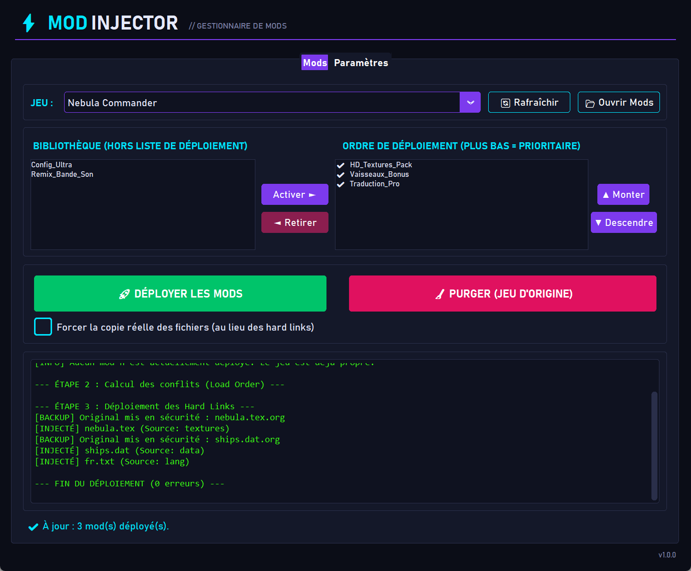
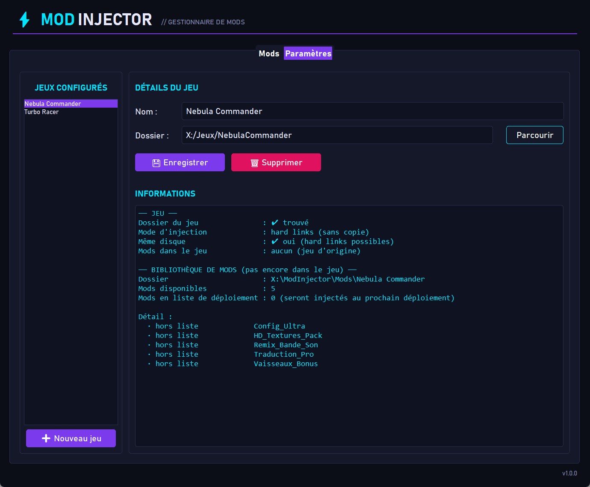
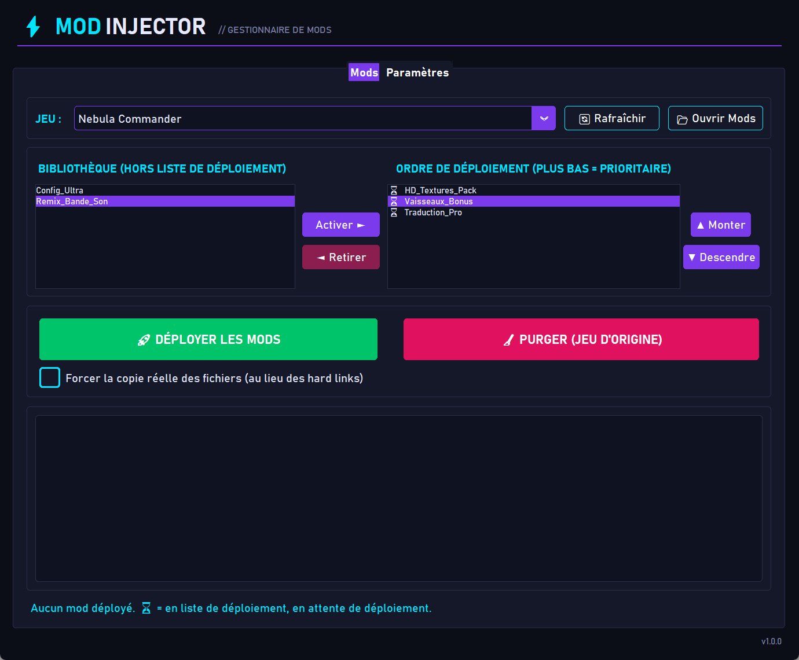

# ModInjector

**ModInjector** est un gestionnaire de mods simple et non destructif pour jeux vidéo sous **Windows**.
Il vous permet de ranger vos mods, de choisir leur ordre de priorité, puis de les injecter dans votre jeu en un clic — et de **restaurer le jeu d'origine** tout aussi facilement.



📘 **Nouveau venu ?** Le [manuel utilisateur illustré](docs/Manuel_utilisateur_ModInjector.docx) (Word) vous guide pas à pas.

## ✨ Fonctionnalités

- 🎮 **Multi-jeux** : gérez plusieurs jeux, chacun avec sa propre bibliothèque de mods.
- 📚 **Bibliothèque de mods** : déposez vos mods dans un dossier, ModInjector les détecte automatiquement.
- 🔢 **Ordre de chargement (load order)** : en cas de conflit entre deux mods, celui placé le plus bas dans la liste est prioritaire.
- ⚡ **Injection instantanée** : utilise des *hard links* (aucune copie, 0 octet supplémentaire sur le disque).
- 📄 **Copie réelle en option** : une case à cocher, propre à chaque jeu, force la copie des fichiers au lieu des hard links.
- 🛡️ **Non destructif** : les fichiers originaux du jeu sont sauvegardés (`.org`) puis restaurés lors de la purge.
- 🧹 **Purge en un clic** : retire tous les mods et remet le jeu dans son état d'origine.
- 🕹️ **Interface « gaming »** : thème sombre aux accents néon, journal façon terminal.

## 📥 Installation

1. Téléchargez la dernière version `ModInjector.zip` depuis la page [Releases](https://github.com/devcfk/ModInjector/releases).
2. Extrayez l'archive **sur le même disque que votre jeu** (voir [Limitations](#️-limitations)).
3. Lancez `ModInjector.exe`.

Le dossier extrait contient :

```
ModInjector/
├── ModInjector.exe
├── Mods/      ← vos mods (un sous-dossier par jeu)
└── data/      ← configuration (config.json)
```

Aucune installation de Python n'est nécessaire.

## 🚀 Utilisation

### 1. Ajouter un jeu
1. Ouvrez l'onglet **Paramètres**.
2. Cliquez sur **➕ Nouveau jeu**, saisissez un nom et sélectionnez le **dossier racine du jeu** (bouton *Parcourir*).
3. Cliquez sur **💾 Enregistrer**.

La fiche d'information vous indique si le dossier est trouvé et si le jeu est sur le même disque que ModInjector.



### 2. Ajouter des mods
1. Dans l'onglet **Mods**, cliquez sur **📂 Ouvrir Mods** : le dossier `Mods/<nom du jeu>/` s'ouvre.
2. Déposez-y chaque mod **dans son propre sous-dossier**. Ce sous-dossier doit reproduire l'arborescence du jeu :

```
Mods/MonJeu/
└── MonSuperMod/
    └── Content/
        └── Paks/
            └── mon_mod.pak     →  sera injecté dans <dossier du jeu>/Content/Paks/mon_mod.pak
```

La liste se met à jour automatiquement (ou via **🔄 Rafraîchir**).

### 3. Choisir et ordonner les mods
- Sélectionnez un mod dans la **Bibliothèque** et cliquez sur **Activer ►**.
- Utilisez **▲ Monter / ▼ Descendre** pour définir l'ordre.
- ⚠️ **Plus bas = prioritaire** : si deux mods modifient le même fichier, celui du bas l'emporte.

Légende de la liste de déploiement :

| Symbole | Signification |
|---------|---------------|
| ✔ | Mod déjà déployé dans le jeu |
| ⏳ | Mod dans la liste, en attente de déploiement |



### 4. Déployer
Cliquez sur **🚀 DÉPLOYER LES MODS**. Le journal affiche chaque étape (purge préalable, calcul des conflits, injection).

> Vous pouvez redéployer à tout moment : ModInjector purge toujours le jeu avant de réinjecter la liste actuelle.

#### Forcer la copie réelle des fichiers
Sous les boutons de déploiement, la case **Forcer la copie réelle des fichiers (au lieu des hard links)** est mémorisée pour chaque jeu. Cochée, ModInjector copie réellement les fichiers des mods dans le jeu :

- le jeu peut alors se trouver **sur un autre disque** que ModInjector ;
- si le jeu modifie un fichier injecté, le fichier du mod dans la bibliothèque **n'est pas touché** ;
- en contrepartie, le déploiement est plus lent et **occupe de l'espace disque** (taille des mods).

Le changement s'applique au prochain déploiement.

### 5. Revenir au jeu d'origine
Cliquez sur **🧹 PURGER (JEU D'ORIGINE)** puis confirmez. Tous les fichiers injectés sont supprimés et les originaux restaurés.

## ⚠️ Limitations

- **Windows uniquement.**
- **ModInjector et le jeu doivent être sur le même disque** (même lettre de lecteur), car les hard links ne fonctionnent pas entre disques. Sinon, déplacez le dossier ModInjector sur le disque du jeu, ou cochez **Forcer la copie réelle des fichiers**.
- Si un hard link échoue, ModInjector se rabat automatiquement sur une copie classique.
- Un fichier injecté par hard link **est** le fichier du mod : si le jeu le modifie sur place, le mod est modifié aussi. ModInjector le signale lors de la purge ; réinstallez alors le mod concerné (ou utilisez la copie réelle pour ce jeu). Un fichier **remplacé** par une mise à jour du jeu est, lui, détecté et conservé lors de la purge.
- **Fermez le jeu avant de déployer ou de purger** : un fichier utilisé par le jeu ne peut pas être supprimé. La purge est alors partielle, ModInjector garde la liste de ce qui reste à faire et il suffit de relancer la purge.
- Si le dernier déploiement a été interrompu (plantage, coupure de courant), un avertissement s'affiche : lancez une purge puis redéployez.
- Pensez à **purger le jeu avant de supprimer un jeu** de ModInjector ou de désinstaller le jeu.
- Les jeux protégés par un anti-triche peuvent refuser les fichiers modifiés : utilisez ModInjector à vos risques.

## ❓ FAQ

**Où sont stockés mes mods et ma configuration ?**
Dans les dossiers `Mods/` et `data/config.json` situés à côté de `ModInjector.exe`.

**Que se passe-t-il si je supprime un jeu de la liste ?**
Le jeu et vos mods ne sont pas supprimés, seulement retirés de la configuration. Purgez d'abord si des mods sont encore déployés.

**J'ai un fichier `.org` dans mon jeu, c'est normal ?**
Oui : c'est la sauvegarde d'un fichier original remplacé par un mod. Il est renommé à son nom d'origine lors de la purge. Si un fichier `.org` existe déjà, la sauvegarde est nommée `.1.org`, `.2.org`… : une sauvegarde n'est jamais écrasée. Un `.org` peut rester après la purge si le jeu a entre-temps installé une version plus récente du fichier : c'est l'ancien original, vous pouvez le supprimer.

## 📘 Documentation

- [Manuel utilisateur](docs/Manuel_utilisateur_ModInjector.docx) (Word, illustré de captures d'écran).
- [Documentation technique](docs/ARCHITECTURE.md).

## 🛠️ Pour les développeurs

Voir la [documentation technique](docs/ARCHITECTURE.md) (architecture, fonctionnement du déploiement, build, contribution).

Lancement rapide depuis les sources (nécessite [uv](https://docs.astral.sh/uv/) et Python ≥ 3.14) :

```powershell
uv sync
uv run python src/modinjector/main.py
```

Tests automatisés : `uv run pytest`.

## 📄 Licence

Ce projet est distribué sous licence [MIT](LICENSE) : vous pouvez l'utiliser, le modifier et le redistribuer librement, y compris à titre commercial, à condition de conserver la mention de copyright.
