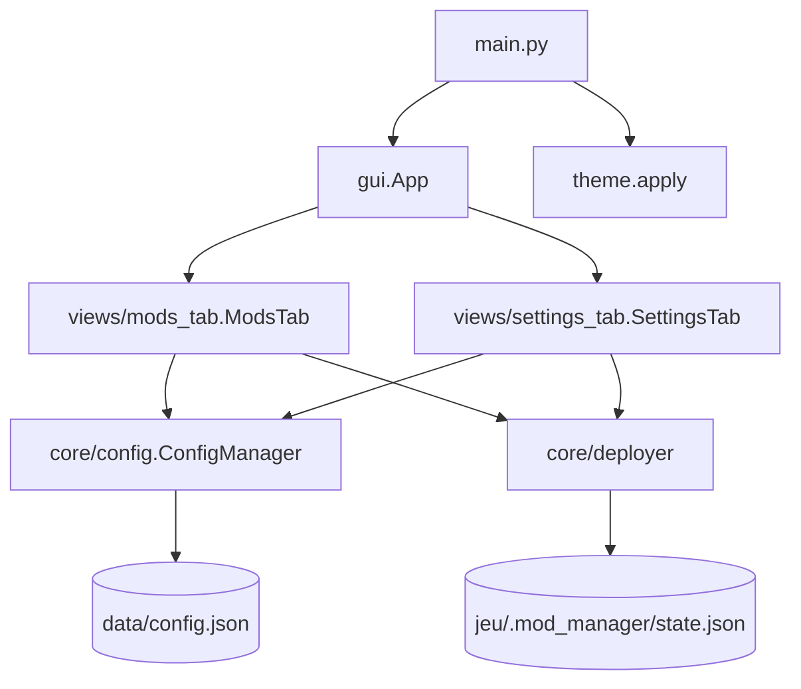
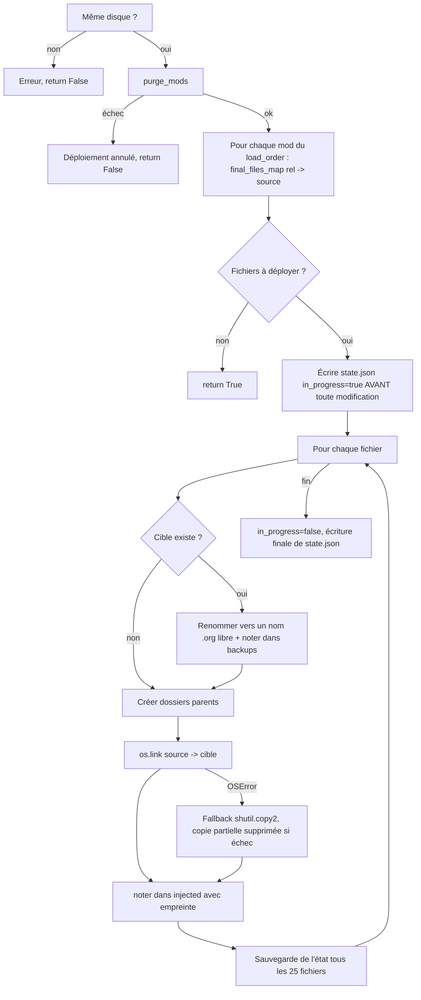

# Documentation technique — ModInjector

Ce document décrit l'architecture, le fonctionnement interne et les procédures de développement de ModInjector.

## 1. Vue d'ensemble

ModInjector est une application de bureau **Python 3.14+** (Windows) avec une GUI **CustomTkinter**. Elle déploie des mods dans un dossier de jeu via des **hard links** (`os.link`), avec sauvegarde des fichiers originaux, et suit l'état du déploiement dans un fichier JSON situé dans le jeu.

### Stack
| Élément | Outil |
|---|---|
| GUI | `customtkinter` (+ `tkinter.Listbox`, `messagebox`, `filedialog`), thème maison dans `theme.py` |
| Images | `pillow` |
| Packaging | `pyinstaller` (`--onefile --noconsole`) |
| Gestion de projet | `uv` (`pyproject.toml`, `uv.lock`) |

## 2. Structure du dépôt

```
ModInjector/
├── assets/icon.ico              # Icône de l'application
├── scripts/build.py             # Build PyInstaller → livraison/ModInjector.zip
├── src/modinjector/
│   ├── main.py                  # Point d'entrée
│   ├── gui.py                   # Fenêtre principale (App), bandeau titre, resource_path
│   ├── theme.py                 # Thème « gaming » : palette, polices, apply()
│   ├── version.py               # __version__
│   ├── core/
│   │   ├── config.py            # ConfigManager : jeux, load order, persistance
│   │   ├── deployer.py          # deploy_mods / purge_mods (logique d'injection)
│   │   └── fsutils.py           # write_json_atomic (écriture JSON sans risque de troncature)
│   └── views/
│       ├── mods_tab.py          # Onglet Mods
│       └── settings_tab.py      # Onglet Paramètres
├── tests/
│   ├── test_deployer.py         # Tests pytest du déploiement / de la purge
│   ├── test_config.py           # Tests pytest de la configuration
│   └── sandbox/                 # Jeux et mods factices pour tests manuels
├── pyproject.toml / uv.lock
└── docs/
    ├── ARCHITECTURE.md          # Ce document
    ├── Manuel_utilisateur_ModInjector.docx  # Manuel utilisateur (Word)
    └── images/                  # Captures d'écran (README, manuel)
```

> Les imports sont relatifs au dossier `src/modinjector` (`from core.config import ...`), configuré via `extraPaths` de pyright et par le lancement du script depuis ce dossier/PyInstaller.

## 3. Architecture en couches



- **Vues** : aucune logique métier ; elles appellent `ConfigManager` et `deployer`.
- **Cœur** : indépendant de la GUI (le `logger` est injecté en paramètre, `print` par défaut), donc testable séparément.

## 4. Modules

### 4.1 `main.py` / `gui.py`
- `main.py` applique le thème (`theme.apply()`) et lance `gui.App().mainloop()`.
- `gui.App` (`CTk`) : titre/icône, bandeau « ⚡ MOD INJECTOR », instancie `ConfigManager`, crée un `CTkTabview` avec les onglets **Mods** et **Paramètres**.
  - Si aucun jeu n'est configuré, l'onglet Paramètres s'ouvre en premier.
  - `on_tab_changed` rafraîchit la vue correspondante.
  - `SettingsTab` reçoit `on_change=mods_view.refresh` pour synchroniser les deux onglets, et `is_busy` pour bloquer les modifications pendant une opération.
  - `on_close` empêche de fermer la fenêtre pendant un déploiement ou une purge.
  - Si `config.json` était illisible, un avertissement indique où il a été mis de côté.
- `resource_path()` : renvoie `sys._MEIPASS` (exécutable PyInstaller) ou la racine du projet en développement.

### 4.2 `theme.py`
Centralise l'apparence de l'application (thème sombre, accents néon).

- **Palette** : constantes `BG`, `PANEL`, `INPUT`, `BORDER`, `TEXT`, `TEXT_MUTED`, `PRIMARY` (violet), `CYAN`, `SUCCESS` (vert, Déployer), `DANGER` (magenta, Purger/Supprimer), `DANGER_SOFT` (Retirer), `CONSOLE_TEXT` (vert terminal).
- **Polices** : `font()` (Bahnschrift, police Windows ; repli automatique si absente) et `mono_font()` (Consolas).
- `apply()` : passe en mode sombre, charge le thème `dark-blue` de CustomTkinter puis surcharge `ctk.ThemeManager.theme` (couleurs, arrondis, bordures). **Doit être appelé avant la création de la fenêtre.**
- Aides pour les widgets que le thème CustomTkinter ne couvre pas : `listbox_options()` (`tk.Listbox`), `console_options()` (zones de logs), `section_label()` (titres de section en majuscules, couleur cyan).

Le thème étant du code Python, aucun fichier supplémentaire n'est à embarquer dans l'exécutable. Pour changer une couleur, modifiez la constante correspondante.

### 4.3 `core/config.py`
Constantes de chemins :
- `APP_DIR` : dossier de l'exécutable si *frozen* (PyInstaller), sinon racine du projet.
- `DATA_DIR = APP_DIR/data`, `CONFIG_FILE = DATA_DIR/config.json`, `MODS_DIR = APP_DIR/Mods`.

`nom_dossier_valide(nom)` : remplace les caractères interdits sous Windows (`<>:"/\|?*`) par `_`.

`ConfigManager` — format de `config.json` :
```json
{
  "jeux": [
    { "nom": "MonJeu", "dossier": "D:/Jeux/MonJeu", "load_order": ["ModA", "ModB"] }
  ],
  "jeu_actif": "MonJeu"
}
```
Les mods d'un jeu sont stockés dans `Mods/<nom_dossier_valide(nom)>/<mod>/`.

| Méthode | Rôle |
|---|---|
| `load()` / `save()` | Persistance JSON (UTF-8). L'écriture est atomique. Un fichier illisible est renommé en `config.corrompu-<date>.json` (il n'est donc pas écrasé par la sauvegarde suivante) et le message est exposé dans `erreur_chargement`. |
| `_migrer_ancien_format()` | Migre l'ancien format mono-jeu (`dossier_jeu`) vers le multi-jeux et déplace `Mods/<mod>` vers `Mods/<jeu>/<mod>`. |
| `noms_jeux()`, `get_jeu()`, `jeu_actif()`, `set_jeu_actif()` | Accès/sélection. |
| `mods_dir(nom)` | Dossier de mods d'un jeu. |
| `ajouter_jeu()`, `modifier_jeu()`, `supprimer_jeu()` | CRUD ; renvoient un message d'erreur ou `None`. Le renommage déplace aussi le dossier de mods. La suppression conserve les mods sur disque. |
| `set_load_order()` | Met à jour et persiste l'ordre d'un jeu. |

### 4.4 `core/deployer.py`
Fonctions utilitaires :
- `is_same_drive(p1, p2)` : compare les lettres de lecteur (prérequis des hard links).
- `load_dir(dossier)` : liste récursive des fichiers relatifs d'un mod (ignore `modinfo.json` et tout dossier `.mod_manager/`).
- `read_state(dossier_jeu)` : lit et valide `state.json` (`None` si absent, `StateError` si illisible) ; convertit l'ancien format.
- `get_deployed_mods(dossier_jeu)` : liste ordonnée des mods déployés (lecture seule, tolérante aux erreurs).
- `is_deploy_interrupted(dossier_jeu)` : vrai si le dernier déploiement a été interrompu ou si l'état est illisible.

L'état est toujours écrit de façon **atomique** (`core/fsutils.write_json_atomic` : fichier temporaire + `os.replace`), jamais tronqué.

#### Format de `state.json` (version 2)
```json
{
  "version": 2,
  "deployed_mods": ["ModA", "ModB"],
  "in_progress": false,
  "injected": {
    "Content/Paks/~mods/x.pak": {"source": "D:/ModInjector/Mods/Jeu/ModA/Content/Paks/~mods/x.pak",
                                 "mode": "link", "size": 1024, "mtime_ns": 0}
  },
  "backups": {"config/game.ini": "config/game.ini.org"}
}
```
- `injected` : fichiers créés par ModInjector, avec leur source, leur mode (`link` ou `copy`) et une empreinte (taille + date) prise à l'injection.
- `backups` : fichier d'origine → nom de sa sauvegarde. Le nom est `<fichier>.org`, ou `<fichier>.1.org`, `<fichier>.2.org`… si ce nom est déjà pris : **une sauvegarde existante n'est jamais écrasée**.
- `in_progress` : vaut `true` pendant le déploiement ; s'il reste à `true`, le déploiement a été interrompu.
- L'ancien format (`injected_files` / `org_files`) est encore lu et purgé correctement.

#### `deploy_mods(dossier_jeu, dossier_mods_racine, load_order, logger)`

**Résolution des conflits** : les mods sont parcourus dans l'ordre ; `final_files_map[rel_path]` est écrasé par les mods suivants → **le dernier mod de la liste gagne**.

**Interruption** : l'état est enregistré avant toute modification, tous les 25 fichiers (`SAVE_EVERY`) et dans un `finally`. Un déploiement interrompu par une exception reste donc entièrement purgeable ; en cas de coupure brutale (crash, extinction), au plus les 25 derniers fichiers peuvent ne pas être suivis — les originaux, eux, ne sont jamais perdus puisque les sauvegardes n'écrasent rien.

#### `purge_mods(dossier_jeu, logger) -> bool`
1. Lit `state.json` (absent : jeu déjà propre → `True` ; illisible : **rien n'est touché** → `False`).
2. Pour chaque fichier injecté :
   - hard link toujours intact (`os.path.samefile`) → supprimé ; si son empreinte a changé, un avertissement signale que le jeu l'a modifié sur place (et donc aussi le fichier source du mod) ;
   - fichier remplacé depuis par le jeu (mise à jour) → **conservé** ;
   - suppression impossible (fichier verrouillé, jeu lancé) → l'entrée est gardée pour une nouvelle tentative.
   Les dossiers parents devenus vides sont supprimés.
3. Chaque sauvegarde est renommée vers son nom d'origine, sauf si un fichier occupe déjà ce nom (il n'est jamais écrasé ; l'ancien original reste dans sa sauvegarde).
4. Tout a réussi → `state.json` et `.mod_manager/` sont supprimés. Sinon, l'état est réécrit avec ce qui reste à faire et la fonction renvoie `False` ; `deploy_mods` refuse alors de redéployer.

Les chemins lus dans l'état sont vérifiés : tout chemin qui sortirait du dossier du jeu est ignoré.

> Le déploiement commence toujours par une purge : il est **idempotent**.

### 4.5 `views/mods_tab.py` — `ModsTab`
- Sélecteur de jeu, deux `Listbox` (Bibliothèque / Ordre de déploiement), boutons Activer/Retirer/Monter/Descendre, boutons Déployer/Purger, zone de logs, barre de statut.
- État en mémoire : `load_order`, `available_mods`.
- `refresh()` : resynchronise avec le disque, retire du `load_order` les mods disparus, persiste si besoin.
- **Détection automatique** : `_poll()` (toutes les 2 s, `POLL_INTERVAL_MS`) compare `_scan()` (jeu, mods présents, mods déployés) à `_snapshot` et rafraîchit si différent.
- Marqueurs : `✔` déployé, `⏳` en attente (comparaison avec `get_deployed_mods`).
- `action_deploy` / `action_purge` : validations, confirmation de purge, puis exécution via `_run_task` **dans un thread** pour ne pas figer l'interface :
  - pendant l'opération, `busy` est vrai : boutons et sélecteur de jeu désactivés, `refresh()`/`_poll()` suspendus, modifications des jeux refusées dans l'onglet Paramètres et fermeture de la fenêtre bloquée (`App.on_close`) ;
  - `self.log` est utilisable depuis le thread : les messages passent par une `queue.Queue` vidée toutes les 100 ms par `_drain_logs` dans le thread de l'UI.
- La barre de statut signale un déploiement interrompu (`is_deploy_interrupted`) et invite à purger.

### 4.6 `views/settings_tab.py` — `SettingsTab`
- Liste des jeux (gauche) et formulaire nom/dossier (droite) + fiche d'information générée par `_build_info` (existence du dossier, même disque, mods déployés, état de chaque mod).
- `save_game` délègue à `ajouter_jeu` ou `modifier_jeu`, affiche l'erreur éventuelle, puis appelle `on_change`.
- `delete_game` : confirmation, appel à `supprimer_jeu`.

## 5. Développement

### Prérequis
- Windows, Python ≥ 3.14, [uv](https://docs.astral.sh/uv/).

### Lancer depuis les sources
```powershell
uv sync
uv run python src/modinjector/main.py
```

### Tests automatisés
```powershell
uv run pytest
```
`tests/test_deployer.py` et `tests/test_config.py` testent le cœur dans des dossiers temporaires : déploiement/purge, priorité du load order, sauvegardes `.org` déjà présentes, fichiers mis à jour par le jeu, purge partielle, déploiement interrompu, état ou config corrompus, ancien format d'état.

### Environnement de test manuel
`tests/sandbox/` contient des jeux (`sandbox_jeu/*`) et mods (`sandbox_mod/*`) factices. Ajoutez un jeu pointant vers un dossier de `sandbox_jeu` pour tester sans risque.
Les artefacts générés (`tests/sandbox/data`, `tests/sandbox/Mods`, `.mod_manager`) sont ignorés par git.

### Build
```powershell
uv run python scripts/build.py
```
Étapes (tout se déroule dans un dossier temporaire `build/` ; `dist/` n'est jamais utilisé) :
1. **Compilation** : PyInstaller (`--onefile --noconsole`, icône, `--add-data assets/icon.ico;assets`, `--collect-all customtkinter`). L'exe, le dossier de travail et le `.spec` sont générés dans `build/`.
2. **Packaging** : assemblage de `ModInjector/` (exe + dossiers `Mods/` et `data/` vides) puis création de `livraison/ModInjector.zip`.
3. **Nettoyage** : suppression de `build/` (et d'un éventuel `dist/` ou `*.spec` résiduel), y compris en cas d'échec.

**Résultat : un unique fichier `livraison/ModInjector.zip`.** Le script renvoie un code de sortie non nul si la compilation échoue.

### Publier une version
1. Mettre à jour `src/modinjector/version.py`.
2. Lancer le build.
3. Créer une *Release* GitHub et y joindre `livraison/ModInjector.zip` (les binaires ne sont pas versionnés dans git).

## 6. Fichiers versionnés ou non

| Versionné | Ignoré (`.gitignore`) |
|---|---|
| `src/`, `scripts/`, `assets/`, `docs/`, `tests/sandbox` (fichiers factices) | `.venv/`, `__pycache__/` |
| `pyproject.toml`, `uv.lock`, `README.md` | `build/`, `dist/`, `livraison/`, `*.spec` |
| `.gitignore`, `.vscode/extensions.json` | `data/`, `Mods/` (données utilisateur) |
|  | `.idea/`, `.vscode/*`, `.mod_manager/`, `*.org` |

## 7. Documentation utilisateur

- `docs/Manuel_utilisateur_ModInjector.docx` : manuel pas à pas destiné aux utilisateurs finaux.
- `docs/images/` : captures utilisées par le manuel et le README.

Les captures sont réalisées sur des **données de démonstration fictives** (jeux « Nebula Commander » et « Turbo Racer », lecteur `X:`) afin de n'exposer aucun chemin ni nom personnel. Après une évolution visible de l'interface, refaites les captures dans les mêmes conditions et mettez le manuel à jour.

## 8. Pistes d'amélioration
- Barre de progression pendant le déploiement de gros mods.
- Internationalisation (textes actuellement en français, noms de variables mixtes).
