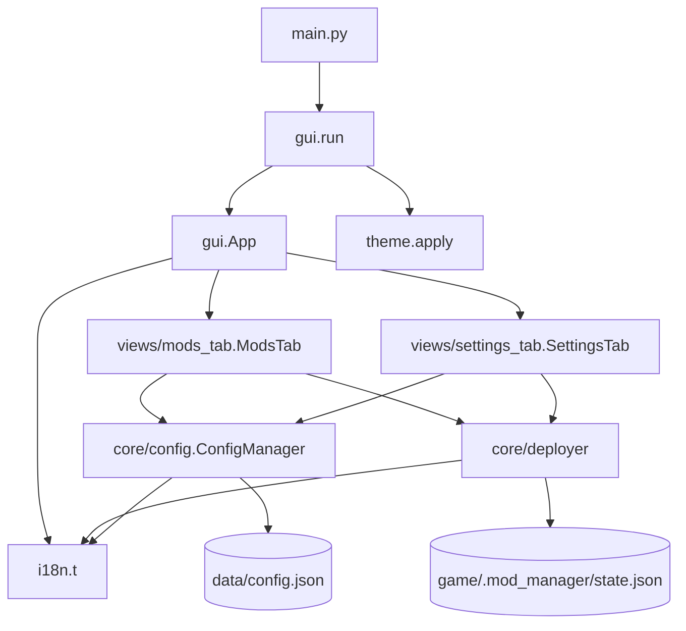
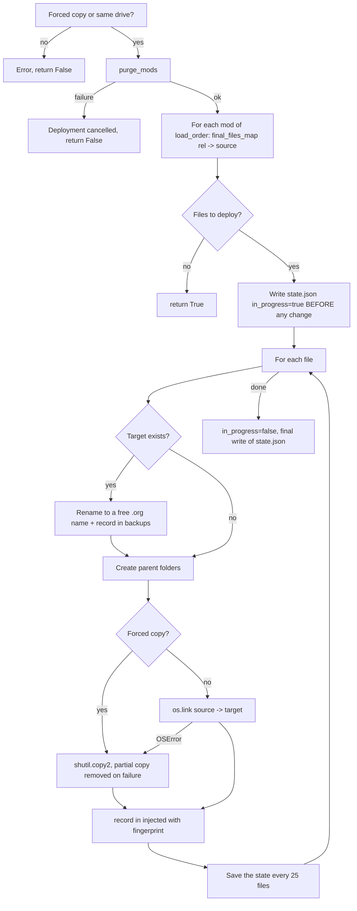

# Technical documentation — ModInjector

This document describes the architecture, the inner workings and the development procedures of ModInjector.

## 1. Overview

ModInjector is a **Python 3.14+** desktop application (Windows) with a **CustomTkinter** GUI. It deploys mods into a game folder using **hard links** (`os.link`), backs up the original files, and tracks the deployment state in a JSON file stored inside the game.

### Stack
| Item | Tool |
|---|---|
| GUI | `customtkinter` (+ `tkinter.Listbox`, `messagebox`, `filedialog`), custom theme in `theme.py` |
| Translations | `i18n.py` + `locales/*.json` (English, French) |
| Images | `pillow` |
| Packaging | `pyinstaller` (`--onefile --noconsole`) |
| Project management | `uv` (`pyproject.toml`, `uv.lock`) |

## 2. Repository layout

```
ModInjector/
├── assets/icon.ico              # Application icon
├── scripts/build.py             # PyInstaller build → livraison/ModInjector.zip
├── src/modinjector/
│   ├── main.py                  # Entry point
│   ├── gui.py                   # Main window (App), title banner, language selector, run()
│   ├── i18n.py                  # Translations: t(), set_language(), system language detection
│   ├── locales/                 # en.json, fr.json: user-facing texts
│   ├── theme.py                 # "Gaming" theme: palette, fonts, apply()
│   ├── version.py               # __version__
│   ├── core/
│   │   ├── config.py            # ConfigManager: games, load order, language, persistence
│   │   ├── deployer.py          # deploy_mods / purge_mods (injection logic)
│   │   └── fsutils.py           # write_json_atomic (JSON writes that can't be truncated)
│   └── views/
│       ├── mods_tab.py          # Mods tab
│       └── settings_tab.py      # Settings tab
├── tests/
│   ├── conftest.py              # Runs every test in English
│   ├── test_deployer.py         # Deployment / purge tests
│   ├── test_config.py           # Configuration tests
│   ├── test_i18n.py             # Translation tests
│   └── sandbox/                 # Fake games and mods for manual testing
├── pyproject.toml / uv.lock
└── docs/
    ├── ARCHITECTURE.md          # This document
    ├── Manuel_utilisateur_ModInjector.docx  # User manual (Word, French)
    └── images/                  # Screenshots (README, manual)
```

> Imports are relative to the `src/modinjector` folder (`from core.config import ...`), configured through pyright's `extraPaths`, pytest's `pythonpath`, and by running the script from that folder / PyInstaller.

## 3. Layered architecture



- **Views**: no business logic; they call `ConfigManager` and `deployer`.
- **Core**: independent from the GUI (the `logger` is passed as a parameter, `print` by default), so it can be tested on its own.
- **Texts**: every user-facing text (UI and logs) comes from `i18n.t()`; no message is hard-coded in the modules.

## 4. Modules

### 4.1 `main.py` / `gui.py`
- `main.py` calls `gui.run()`, which applies the theme (`theme.apply()`) and shows the window. When the language is changed, the window is destroyed and `run()` rebuilds it in the new language (reopening the Settings tab if that is where the change was made).
- `gui.App` (`CTk`): title/icon, "⚡ MOD INJECTOR" banner with the 🌐 language selector, creates the `ConfigManager`, applies its language (`i18n.set_language`), and creates a `CTkTabview` with the **Mods** and **Settings** tabs.
  - If no game is configured, the Settings tab opens first.
  - `on_tab_changed` refreshes the matching view.
  - `SettingsTab` gets `on_change=mods_view.refresh` to keep both tabs in sync, and `is_busy` to block changes during an operation.
  - `on_close` prevents closing the window during a deployment or a purge; the language cannot be changed either.
  - `on_language_selected` saves the language, cancels the window's pending Tk timers (otherwise they would fire on destroyed widgets), then closes the window so that `run()` rebuilds it.
  - If `config.json` could not be read, a warning says where it was set aside.
- `resource_path()`: returns `sys._MEIPASS` (PyInstaller executable) or the project root during development.

### 4.2 `i18n.py` — translations
- Texts live in `locales/<code>.json`: one flat `{key: text}` object per language. Keys are grouped by prefix (`mods.*`, `settings.*`, `info.*`, `purge.*`, `deploy.*`…).
- `t(key, **values)` returns the text in the current language and fills its `{placeholders}` (`str.format`). A key missing from a language falls back to English (the reference language), then to the key itself.
- `set_language(code)`: `"auto"` follows the Windows display language (`detect_system_language()`, via `GetUserDefaultUILanguage`, falling back to `locale`); an unsupported language falls back to English. The choice is stored as `language` in `config.json`.
- `LANGUAGES` lists the supported languages, each named in its own language for the selector.
- Folder location: next to `i18n.py` from source, inside the PyInstaller bundle (`sys._MEIPASS/locales`) once frozen. `scripts/build.py` adds it with `--add-data`.

**Adding a language**: copy `locales/en.json` to `locales/<code>.json`, translate the values (keep the keys and the `{placeholders}`), and add the code to `LANGUAGES`. `tests/test_i18n.py` checks that every language has exactly the same keys and placeholders as English.

**Adding a text**: add the key to **every** file in `locales/`, then use `t("my.key")` in the code.

### 4.3 `theme.py`
Centralizes the look of the application (dark theme, neon accents).

- **Palette**: constants `BG`, `PANEL`, `INPUT`, `BORDER`, `TEXT`, `TEXT_MUTED`, `PRIMARY` (purple), `CYAN`, `SUCCESS` (green, Deploy), `DANGER` (magenta, Purge/Delete), `DANGER_SOFT` (Remove), `CONSOLE_TEXT` (terminal green).
- **Fonts**: `font()` (Bahnschrift, a Windows font; automatic fallback if missing) and `mono_font()` (Consolas).
- `apply()`: switches to dark mode, loads CustomTkinter's `dark-blue` theme, then overrides `ctk.ThemeManager.theme` (colors, corner radius, borders). **Must be called before the window is created.**
- Helpers for the widgets that the CustomTkinter theme does not cover: `listbox_options()` (`tk.Listbox`), `console_options()` (log areas), `section_label()` (upper-case section titles in cyan).

Since the theme is Python code, no extra file has to be bundled in the executable. To change a color, edit the matching constant.

### 4.4 `core/config.py`
Path constants:
- `APP_DIR`: folder of the executable when *frozen* (PyInstaller), otherwise the project root.
- `DATA_DIR = APP_DIR/data`, `CONFIG_FILE = DATA_DIR/config.json`, `MODS_DIR = APP_DIR/Mods`.

`safe_folder_name(name)`: replaces the characters forbidden on Windows (`<>:"/\|?*`) with `_`.

`ConfigManager` — `config.json` format:
```json
{
  "games": [
    { "name": "MyGame", "game_dir": "D:/Games/MyGame", "load_order": ["ModA", "ModB"], "force_copy": false }
  ],
  "active_game": "MyGame",
  "language": "auto"
}
```
A game's mods are stored in `Mods/<safe_folder_name(name)>/<mod>/`.
`force_copy` (`false` by default) forces real file copies when deploying this game.
`language` is `"auto"` (Windows language), `"en"` or `"fr"`.

Older formats are converted on load: French keys from v1.0/v1.1 (`jeux`, `nom`, `dossier`, `copie_forcee`, `jeu_actif`, rewritten right away in the new format) and the single-game format (`dossier_jeu`).

| Method | Role |
|---|---|
| `load()` / `save()` | JSON persistence (UTF-8). Writes are atomic. An unreadable file is renamed to `config.corrupted-<date>.json` (so the next save does not overwrite it) and the message is exposed in `load_error`. |
| `_migrate_single_game_format()` | Migrates the old single-game format (`dossier_jeu`) to multi-game and moves `Mods/<mod>` to `Mods/<game>/<mod>`. |
| `game_names()`, `get_game()`, `active_game()`, `set_active_game()` | Lookup / selection. |
| `mods_dir(name)` | A game's mods folder. |
| `add_game()`, `update_game()`, `remove_game()` | CRUD; return an error message or `None`. Renaming also moves the mods folder. Removing keeps the mods on disk. |
| `set_load_order()` | Updates and saves a game's order. |
| `set_force_copy()` | Enables or disables forced real copies for a game, and saves. |
| `set_language()` | Saves the interface language. |

### 4.5 `core/deployer.py`
Helper functions:
- `is_same_drive(p1, p2)`: compares drive letters (required for hard links).
- `load_dir(mod_dir)`: recursive list of a mod's relative file paths (skips `modinfo.json` and any `.mod_manager/` folder).
- `read_state(game_dir)`: reads and validates `state.json` (`None` if missing, `StateError` if unreadable); converts the old format.
- `get_deployed_mods(game_dir)`: ordered list of deployed mods (read-only, tolerant to errors).
- `is_deploy_interrupted(game_dir)`: true if the last deployment was interrupted or if the state cannot be read.

The state is always written **atomically** (`core/fsutils.write_json_atomic`: temporary file + `os.replace`), never truncated.

#### `state.json` format (version 2)
```json
{
  "version": 2,
  "deployed_mods": ["ModA", "ModB"],
  "in_progress": false,
  "injected": {
    "Content/Paks/~mods/x.pak": {"source": "D:/ModInjector/Mods/Game/ModA/Content/Paks/~mods/x.pak",
                                 "mode": "link", "size": 1024, "mtime_ns": 0}
  },
  "backups": {"config/game.ini": "config/game.ini.org"}
}
```
- `injected`: files created by ModInjector, with their source, their mode (`link` or `copy`) and a fingerprint (size + date) taken at injection time.
- `backups`: original file → name of its backup. The name is `<file>.org`, or `<file>.1.org`, `<file>.2.org`… if that name is taken: **an existing backup is never overwritten**.
- `in_progress`: `true` during the deployment; if it stays `true`, the deployment was interrupted.
- The old format (`injected_files` / `org_files`) is still read and purged correctly.

#### `deploy_mods(game_dir, mods_root, load_order, logger, force_copy=False)`
With `force_copy=True`, no hard link is attempted: every file is copied (`shutil.copy2`, mode `copy` in the state) and the "same drive" check is skipped. The purge handles these copies like fallback copies (fingerprint comparison).


**Conflict resolution**: mods are processed in order; `final_files_map[rel_path]` is overwritten by the following mods → **the last mod in the list wins**.

**Interruption**: the state is saved before any change, every 25 files (`SAVE_EVERY`) and in a `finally`. A deployment interrupted by an exception can therefore be fully purged; after a hard stop (crash, power loss), at most the last 25 files may be untracked — the originals are never lost, since backups never overwrite anything.

#### `purge_mods(game_dir, logger) -> bool`
1. Reads `state.json` (missing: game already clean → `True`; unreadable: **nothing is touched** → `False`).
2. For each injected file:
   - hard link still intact (`os.path.samefile`) → deleted; if its fingerprint changed, a warning says the game modified it in place (and therefore the mod's source file too);
   - file replaced by the game since then (update) → **kept**;
   - deletion impossible (locked file, game running) → the entry is kept for another attempt.
   Parent folders left empty are removed.
3. Each backup is renamed back to its original name, unless a file already uses that name (it is never overwritten; the old original stays in its backup).
4. Everything succeeded → `state.json` and `.mod_manager/` are removed. Otherwise, the state is rewritten with what is left to do and the function returns `False`; `deploy_mods` then refuses to redeploy.

Paths read from the state are checked: any path that would escape the game folder is skipped.

> A deployment always starts with a purge: it is **idempotent**.

### 4.6 `views/mods_tab.py` — `ModsTab`
- Game selector, two `Listbox` (Library / Deployment order), Enable/Remove/Up/Down buttons, Deploy/Purge buttons, "Force real file copy" checkbox, log area, status bar.
- The checkbox reflects the active game's `force_copy` (`refresh()`), saves it on every click (`on_force_copy_toggled` → `set_force_copy`) and is passed to `deploy_mods`. It is disabled when there is no game and during an operation.
- In-memory state: `load_order`, `available_mods`.
- `refresh()`: resyncs with the disk, removes vanished mods from `load_order`, saves if needed.
- **Automatic detection**: `_poll()` (every 2 s, `POLL_INTERVAL_MS`) compares `_scan()` (game, present mods, deployed mods) with `_snapshot` and refreshes if they differ.
- Markers: `✔` deployed, `⏳` pending (compared with `get_deployed_mods`).
- `action_deploy` / `action_purge`: checks, purge confirmation, then run through `_run_task` **in a thread** so the UI does not freeze:
  - during the operation, `busy` is true: buttons and game selector disabled, `refresh()`/`_poll()` suspended, game changes refused in the Settings tab, window closing and language change blocked;
  - `self.log` can be used from the thread: messages go through a `queue.Queue` drained every 100 ms by `_drain_logs` in the UI thread.
- The status bar reports an interrupted deployment (`is_deploy_interrupted`) and suggests a purge.

### 4.7 `views/settings_tab.py` — `SettingsTab`
- List of games (left) and name/folder form (right) + info sheet built by `_build_info` (folder found, injection mode, same drive, deployed mods, status of each mod). The labels are aligned on the longest one in the current language.
- `save_game` delegates to `add_game` or `update_game`, shows the error if any, then calls `on_change`.
- `delete_game`: confirmation, then `remove_game`.

## 5. Development

### Requirements
- Windows, Python ≥ 3.14, [uv](https://docs.astral.sh/uv/).

### Run from source
```powershell
uv sync
uv run python src/modinjector/main.py
```

### Automated tests
```powershell
uv run pytest
```
`tests/test_deployer.py` and `tests/test_config.py` test the core in temporary folders: deploy/purge, load order priority, existing `.org` backups, files updated by the game, partial purge, interrupted deployment, corrupted state or config, old state and configuration formats, forced real copy (including on another drive). `tests/test_i18n.py` checks the translation files (same keys and placeholders in every language), the fallbacks, and that the build bundles `locales/`. `tests/conftest.py` runs every test in English.

### Code quality
```powershell
uv run ruff check .          # lint (rules in [tool.ruff] of pyproject.toml)
uv run ruff format .         # automatic formatting
```
Ruff, pytest and PyInstaller are development dependencies (`dev` group), installed by `uv sync`.

### Continuous integration (GitHub Actions)
- `.github/workflows/ci.yml`: on every push to `main` and every pull request, checks lint, formatting and tests on Windows (`Lint and tests` job, required by the `main` ruleset).
- `.github/workflows/release.yml`: on every `V*` tag, runs the tests again, checks that the tag matches the version in `pyproject.toml`, builds and publishes the release with `ModInjector.zip`.
- `.github/dependabot.yml`: suggests monthly updates of the Python dependencies and the GitHub Actions.

### Manual test environment
`tests/sandbox/` contains fake games (`sandbox_jeu/*`) and mods (`sandbox_mod/*`). Add a game pointing to a `sandbox_jeu` folder to test safely.
Generated artifacts (`tests/sandbox/data`, `tests/sandbox/Mods`, `.mod_manager`) are ignored by git.

### Build
```powershell
uv run python scripts/build.py
```
Steps (everything happens in a temporary `build/` folder; `dist/` is never used):
1. **Compilation**: PyInstaller (`--onefile --noconsole`, icon, `--add-data assets/icon.ico;assets`, `--add-data src/modinjector/locales;locales`, `--collect-all customtkinter`). The exe, the work folder and the `.spec` are generated in `build/`.
2. **Packaging**: assembles `ModInjector/` (exe + empty `Mods/` and `data/` folders), then creates `livraison/ModInjector.zip`.
3. **Cleanup**: removes `build/` (and any leftover `dist/` or `*.spec`), even on failure.

**Result: a single `livraison/ModInjector.zip` file.** The script returns a non-zero exit code if the compilation fails.

### Publishing a version
1. Update the version in `pyproject.toml` **and** `src/modinjector/version.py`, then commit to `main` (through a pull request).
2. Create and push the matching tag:
   ```powershell
   git tag V1.2.0
   git push origin V1.2.0
   ```
3. The *Release* workflow builds the executable and publishes the GitHub release with `ModInjector.zip` (binaries are not versioned in git).

A local build (`uv run python scripts/build.py`) is still possible to test the executable.

## 6. Versioned and ignored files

| Versioned | Ignored (`.gitignore`) |
|---|---|
| `src/`, `scripts/`, `assets/`, `docs/`, `tests/sandbox` (fake files) | `.venv/`, `__pycache__/` |
| `pyproject.toml`, `uv.lock`, `README.md` (English), `README.fr.md` | `build/`, `dist/`, `livraison/`, `*.spec` |
| `.gitignore`, `.gitattributes`, `.editorconfig`, `.github/`, `.vscode/extensions.json` | `data/`, `Mods/` (user data) |
|  | `.idea/`, `.vscode/*`, `.mod_manager/`, `*.org` |

## 7. User documentation

- `docs/Manuel_utilisateur_ModInjector.docx`: step-by-step manual for end users (French).
- `docs/images/`: screenshots used by the manual and the README.

Screenshots are taken with **fictitious demo data** (games "Nebula Commander" and "Turbo Racer", drive `X:`) so that no personal path or name is exposed. After a visible UI change, retake the screenshots under the same conditions and update the manual.

## 8. Ideas for improvement
- Progress bar while deploying large mods.
- English version of the user manual and of the screenshots.
