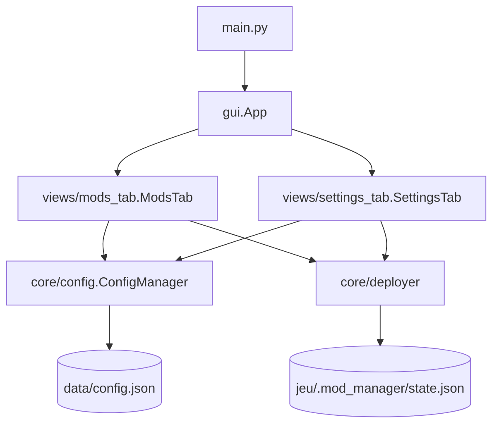
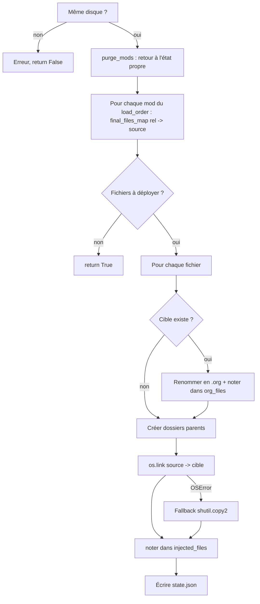

# Documentation technique — ModInjector

Ce document décrit l'architecture, le fonctionnement interne et les procédures de développement de ModInjector.

## 1. Vue d'ensemble

ModInjector est une application de bureau **Python 3.14+** (Windows) avec une GUI **CustomTkinter**. Elle déploie des mods dans un dossier de jeu via des **hard links** (`os.link`), avec sauvegarde des fichiers originaux, et suit l'état du déploiement dans un fichier JSON situé dans le jeu.

### Stack
| Élément | Outil |
|---|---|
| GUI | `customtkinter` (+ `tkinter.Listbox`, `messagebox`, `filedialog`) |
| Images | `pillow` |
| Packaging | `pyinstaller` (`--onefile --noconsole`) |
| Gestion de projet | `uv` (`pyproject.toml`, `uv.lock`) |

## 2. Structure du dépôt

```
ModInjector/
├── assets/icon.ico              # Icône de l'application
├── scripts/build.py             # Build PyInstaller → livraison/ModInjector.zip
├── src/modinjector/
│   ├── main.py                  # Point d'entrée
│   ├── gui.py                   # Fenêtre principale (App), resource_path
│   ├── version.py               # __version__
│   ├── core/
│   │   ├── config.py            # ConfigManager : jeux, load order, persistance
│   │   └── deployer.py          # deploy_mods / purge_mods (logique d'injection)
│   └── views/
│       ├── mods_tab.py          # Onglet Mods
│       └── settings_tab.py      # Onglet Paramètres
├── tests/sandbox/               # Jeux et mods factices pour tests manuels
├── pyproject.toml / uv.lock
└── docs/ARCHITECTURE.md
```

> Les imports sont relatifs au dossier `src/modinjector` (`from core.config import ...`), configuré via `extraPaths` de pyright et par le lancement du script depuis ce dossier/PyInstaller.

## 3. Architecture en couches



- **Vues** : aucune logique métier ; elles appellent `ConfigManager` et `deployer`.
- **Cœur** : indépendant de la GUI (le `logger` est injecté en paramètre, `print` par défaut), donc testable séparément.

## 4. Modules

### 4.1 `main.py` / `gui.py`
- `main.py` configure le thème (`dark`, `blue`) et lance `gui.App().mainloop()`.
- `gui.App` (`CTk`) : titre/icône, instancie `ConfigManager`, crée un `CTkTabview` avec les onglets **Mods** et **Paramètres**.
  - Si aucun jeu n'est configuré, l'onglet Paramètres s'ouvre en premier.
  - `on_tab_changed` rafraîchit la vue correspondante.
  - `SettingsTab` reçoit `on_change=mods_view.refresh` pour synchroniser les deux onglets.
- `resource_path()` : renvoie `sys._MEIPASS` (exécutable PyInstaller) ou la racine du projet en développement.

### 4.2 `core/config.py`
Constantes de chemins :
- `APP_DIR` : dossier de l'exécutable si *frozen* (PyInstaller), sinon racine du projet.
- `DATA_DIR = APP_DIR/data`, `CONFIG_FILE = DATA_DIR/config.json`, `MODS_DIR = APP_DIR/Mods`.

`nom_dossier_valide(nom)` : remplace les caractères interdits sous Windows (`<>:"/\|?*`) par `_`.

`ConfigManager` — format de `config.json` :
```json
{
  "jeux": [
    { "nom": "MonJeu", "dossier": "D:/Jeux/MonJeu", "load_order": ["ModA", "ModB"] }
  ],
  "jeu_actif": "MonJeu"
}
```
Les mods d'un jeu sont stockés dans `Mods/<nom_dossier_valide(nom)>/<mod>/`.

| Méthode | Rôle |
|---|---|
| `load()` / `save()` | Persistance JSON (UTF-8). |
| `_migrer_ancien_format()` | Migre l'ancien format mono-jeu (`dossier_jeu`) vers le multi-jeux et déplace `Mods/<mod>` vers `Mods/<jeu>/<mod>`. |
| `noms_jeux()`, `get_jeu()`, `jeu_actif()`, `set_jeu_actif()` | Accès/sélection. |
| `mods_dir(nom)` | Dossier de mods d'un jeu. |
| `ajouter_jeu()`, `modifier_jeu()`, `supprimer_jeu()` | CRUD ; renvoient un message d'erreur ou `None`. Le renommage déplace aussi le dossier de mods. La suppression conserve les mods sur disque. |
| `set_load_order()` | Met à jour et persiste l'ordre d'un jeu. |

### 4.3 `core/deployer.py`
Fonctions utilitaires :
- `is_same_drive(p1, p2)` : compare les lettres de lecteur (prérequis des hard links).
- `load_dir(dossier)` : liste récursive des fichiers relatifs d'un mod (ignore `modinfo.json`).
- `get_state_file(dossier_jeu)` : crée `.mod_manager/` et renvoie `state.json`.
- `get_deployed_mods(dossier_jeu)` : liste ordonnée des mods déployés (lecture seule, tolérante aux erreurs).

#### Format de `state.json`
```json
{
  "deployed_mods": ["ModA", "ModB"],
  "injected_files": ["Content/Paks/~mods/x.pak"],
  "org_files": ["config/game.ini"]
}
```
- `injected_files` : chemins relatifs créés par ModInjector.
- `org_files` : chemins relatifs dont l'original a été renommé en `.org`.

#### `deploy_mods(dossier_jeu, dossier_mods_racine, load_order, logger)`

**Résolution des conflits** : les mods sont parcourus dans l'ordre ; `final_files_map[rel_path]` est écrasé par les mods suivants → **le dernier mod de la liste gagne**.

#### `purge_mods(dossier_jeu, logger)`
1. Lit `state.json` (si absent : jeu déjà propre).
2. Supprime chaque fichier de `injected_files` et remonte en supprimant les dossiers parents devenus vides.
3. Renomme chaque `<fichier>.org` de `org_files` vers son nom d'origine.
4. Supprime `state.json`.

> Le déploiement commence toujours par une purge : il est **idempotent**.

### 4.4 `views/mods_tab.py` — `ModsTab`
- Sélecteur de jeu, deux `Listbox` (Bibliothèque / Ordre de déploiement), boutons Activer/Retirer/Monter/Descendre, boutons Déployer/Purger, zone de logs, barre de statut.
- État en mémoire : `load_order`, `available_mods`.
- `refresh()` : resynchronise avec le disque, retire du `load_order` les mods disparus, persiste si besoin.
- **Détection automatique** : `_poll()` (toutes les 2 s, `POLL_INTERVAL_MS`) compare `_scan()` (jeu, mods présents, mods déployés) à `_snapshot` et rafraîchit si différent.
- Marqueurs : `✔` déployé, `⏳` en attente (comparaison avec `get_deployed_mods`).
- `action_deploy` / `action_purge` : validations, confirmation de purge, logs via le callback `self.log`.

### 4.5 `views/settings_tab.py` — `SettingsTab`
- Liste des jeux (gauche) et formulaire nom/dossier (droite) + fiche d'information générée par `_build_info` (existence du dossier, même disque, mods déployés, état de chaque mod).
- `save_game` délègue à `ajouter_jeu` ou `modifier_jeu`, affiche l'erreur éventuelle, puis appelle `on_change`.
- `delete_game` : confirmation, appel à `supprimer_jeu`.

## 5. Développement

### Prérequis
- Windows, Python ≥ 3.14, [uv](https://docs.astral.sh/uv/).

### Lancer depuis les sources
```powershell
uv sync
uv run python src/modinjector/main.py
```

### Environnement de test
`tests/sandbox/` contient des jeux (`sandbox_jeu/*`) et mods (`sandbox_mod/*`) factices. Ajoutez un jeu pointant vers un dossier de `sandbox_jeu` pour tester sans risque.
Les artefacts générés (`tests/sandbox/data`, `tests/sandbox/Mods`, `.mod_manager`) sont ignorés par git.

### Build
```powershell
uv run python scripts/build.py
```
Étapes (tout se déroule dans un dossier temporaire `build/` ; `dist/` n'est jamais utilisé) :
1. **Compilation** : PyInstaller (`--onefile --noconsole`, icône, `--add-data assets/icon.ico;assets`, `--collect-all customtkinter`). L'exe, le dossier de travail et le `.spec` sont générés dans `build/`.
2. **Packaging** : assemblage de `ModInjector/` (exe + dossiers `Mods/` et `data/` vides) puis création de `livraison/ModInjector.zip`.
3. **Nettoyage** : suppression de `build/` (et d'un éventuel `dist/` ou `*.spec` résiduel), y compris en cas d'échec.

**Résultat : un unique fichier `livraison/ModInjector.zip`.** Le script renvoie un code de sortie non nul si la compilation échoue.

### Publier une version
1. Mettre à jour `src/modinjector/version.py`.
2. Lancer le build.
3. Créer une *Release* GitHub et y joindre `livraison/ModInjector.zip` (les binaires ne sont pas versionnés dans git).

## 6. Fichiers versionnés ou non

| Versionné | Ignoré (`.gitignore`) |
|---|---|
| `src/`, `scripts/`, `assets/`, `docs/`, `tests/sandbox` (fichiers factices) | `.venv/`, `__pycache__/` |
| `pyproject.toml`, `uv.lock`, `README.md` | `build/`, `dist/`, `livraison/`, `*.spec` |
| `.gitignore`, `.vscode/extensions.json` | `data/`, `Mods/` (données utilisateur) |
|  | `.idea/`, `.vscode/*`, `.mod_manager/`, `*.org` |

## 7. Pistes d'amélioration
- Tests automatisés (`pytest`) du cœur (`deployer`, `config`) à partir de `tests/sandbox`.
- Exécuter déploiement/purge dans un thread pour ne pas figer l'UI sur de gros mods.
- Internationalisation (textes actuellement en français, noms de variables mixtes).
